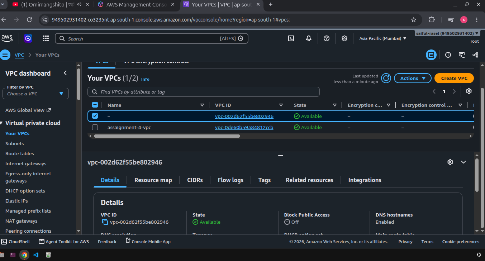
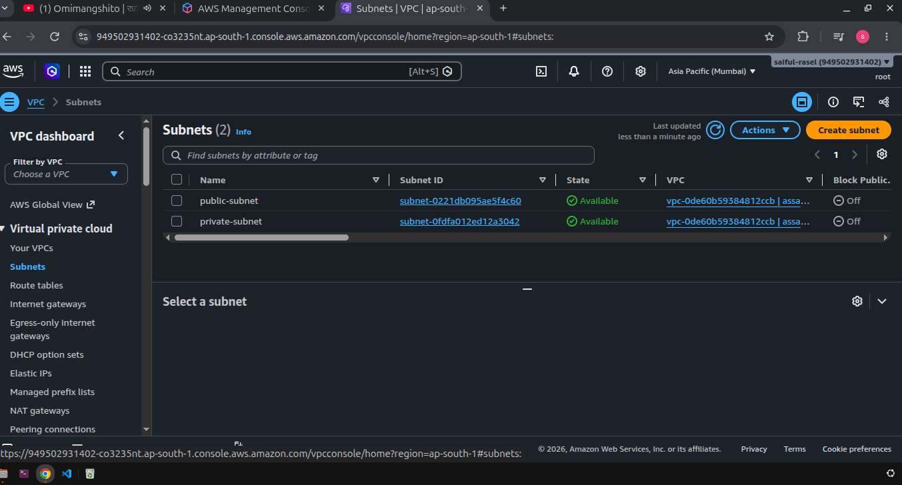
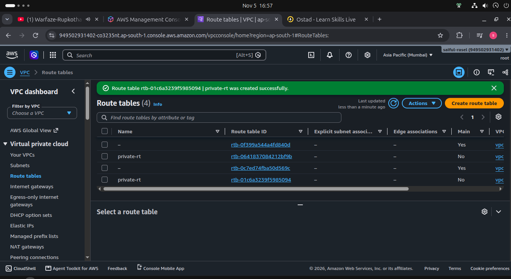
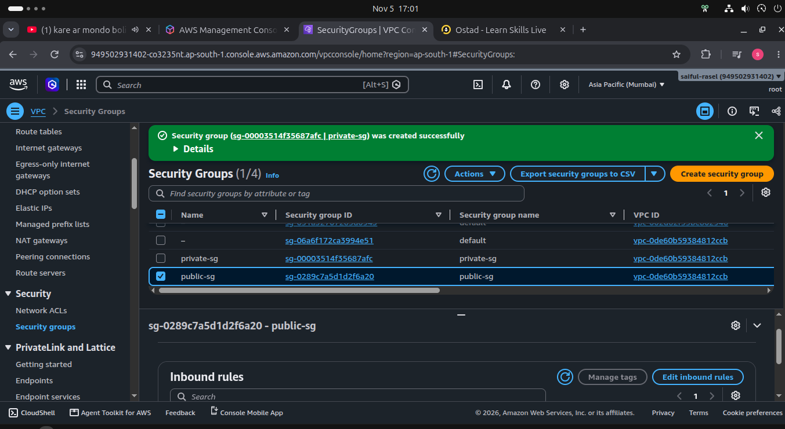
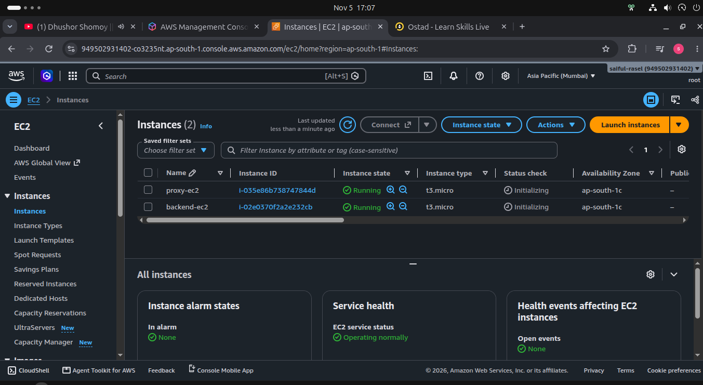
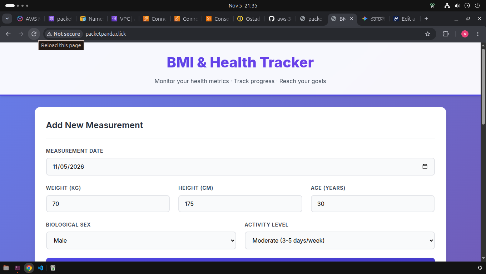
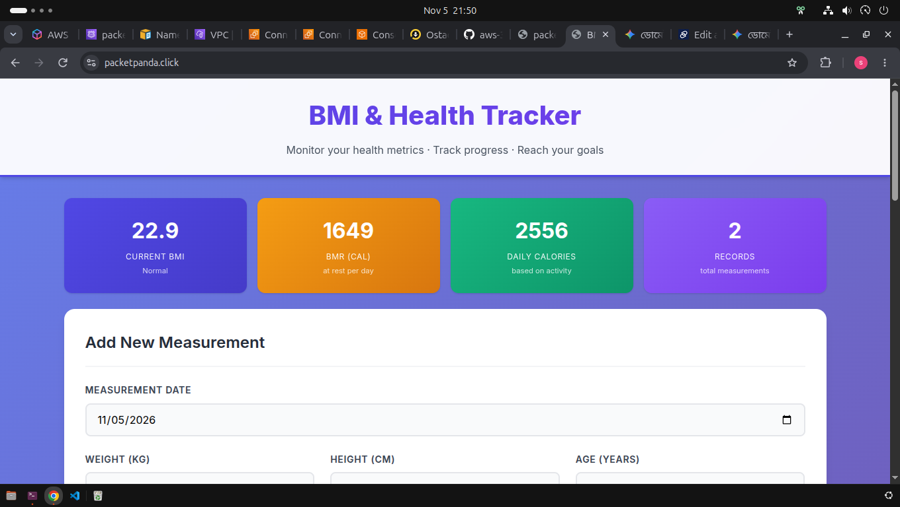

---

# Screenshots
##  this is vpc 

## this is subnet

## this is Route Table

## this is Security Group

## this is instance

## this is browser where my server requested by only 80 port by nginx

## this is browser where my server now received 443 port 80 port close for security 

